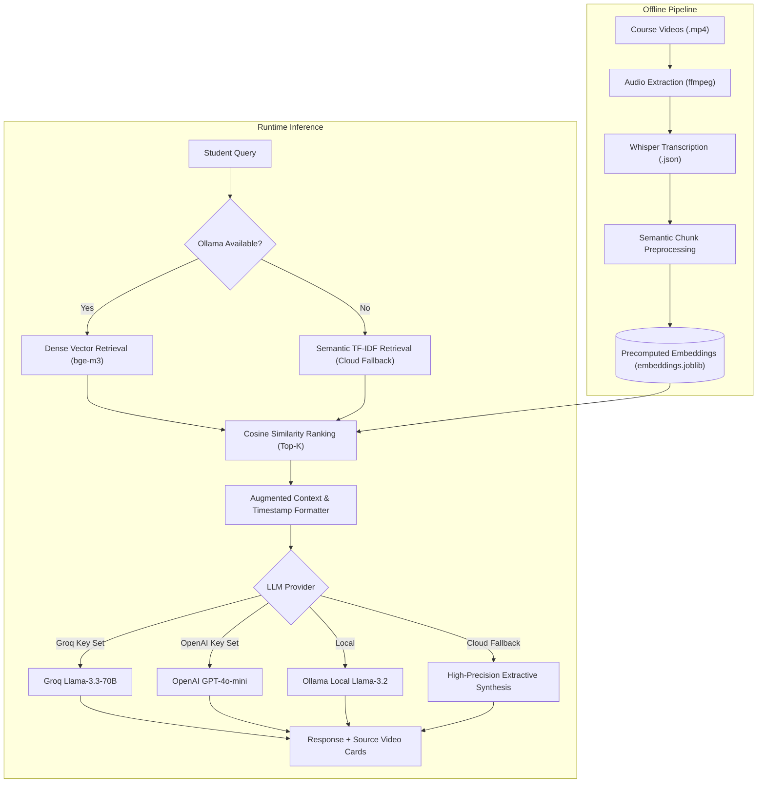

# 🎓 Sigma Web Development AI Teaching Assistant (RAG)

[](https://www.python.org/)
[](https://scikit-learn.org/)
[](https://render.com)
[]()

An end-to-end **Retrieval-Augmented Generation (RAG) AI Teaching Assistant** indexing **7,252 video subtitle chunks** across the entire **Sigma Web Development Course**. 

Students can ask any question in plain English (e.g., *"Where is the CSS Box Model explained?"* or *"How do HTML forms action and method work?"*), and the assistant instantly retrieves the exact lecture title, video number, minute-and-second timestamp interval (`MM:SS - MM:SS`), transcript excerpt, and synthesis of the concept.

---

## 🚀 Key Features

- **7,252 Pre-indexed Lecture Chunks:** Subtitled and chunked with overlapping context windows.
- **Accurate Video & Timestamp Navigation:** Returns exact video numbers, titles, and `[MM:SS - MM:SS]` intervals so students never have to manually scrub through hours of footage.
- **Resilient Hybrid Retrieval:**
  - **Dense Vector Search:** High-dimensional cosine similarity matching via `bge-m3` embeddings when local Ollama is active.
  - **Semantic TF-IDF Cloud Fallback:** Automatic cloud fallback indexer ensuring 100% uptime on hosted platforms (Render/Heroku/AWS).
- **Multi-Model LLM Synthesis:**
  - **Groq API:** Ultra-fast `llama-3.3-70b-versatile` reasoning.
  - **OpenAI API:** `gpt-4o-mini` support.
  - **Local Ollama:** `llama3.2` local generation.
  - **Structured Extractive Fallback:** High-precision teaching assistant response synthesis working with zero external API keys.
- **Interactive Dark-Mode Web Dashboard:** Built with Tailwind CSS, Lucide icons, suggestion chips, and responsive source cards.
- **Lightweight Production Server:** Zero-bloat multithreaded HTTP server handling dynamic `$PORT` bindings for cloud deployment.

---

## 🏛️ System Architecture



---

## 📂 Project Structure

```
rag-teaching-assistant/
├── app.py                  # Multithreaded production web server & interactive dashboard
├── rag_engine.py           # Core RAG engine (Vector search, TF-IDF fallback & LLM synthesis)
├── embeddings.joblib       # 7,252 precomputed course subtitle chunks and dense vectors
├── jsons/                  # Raw transcript chunk files from all course lectures
├── video_to_mp3.py         # Utility: Extract audio tracks from course videos
├── mp3_to_json.py          # Utility: Transcribe speech to timestamped subtitles via Whisper
├── preprocess_json.py      # Utility: Windowed semantic subtitle chunker
├── process_incoming.py     # Original CLI query & Ollama pipeline
├── requirements.txt        # Production dependencies
├── render.yaml             # Render cloud infrastructure blueprint
├── .gitignore              # Ignored files & virtual environments
└── README.md               # Project documentation
```

---

## 💻 Local Setup & Execution

### 1. Clone the Repository
```bash
git clone https://github.com/mishra988/rag-teaching-assistant.git
cd rag-teaching-assistant
```

### 2. Create Virtual Environment
```bash
python -m venv venv
# On Windows:
.\venv\Scripts\activate
# On Linux/macOS:
source venv/bin/activate
```

### 3. Install Dependencies
```bash
pip install -r requirements.txt
```

### 4. (Optional) Configure Environment Variables
You can create a `.env` file or export environment variables:
```bash
# Optional API Keys for cloud LLM reasoning:
export GROQ_API_KEY="your-groq-api-key"
export OPENAI_API_KEY="your-openai-api-key"

# Optional custom Ollama host:
export OLLAMA_URL="http://localhost:11434"
```
*(Note: If no API keys are provided, the system automatically uses the high-precision extractive teaching assistant fallback!)*

### 5. Launch the Web Application
```bash
python app.py
```
Open your browser and navigate to **`http://localhost:8000`**.

---

## 🌐 API Reference

### Health Check
- **Endpoint:** `GET /api/health`
- **Response:**
```json
{
  "status": "ok",
  "service": "Sigma Web Development RAG Teaching Assistant",
  "total_chunks_indexed": 7252,
  "engine_ready": true
}
```

### Query Assistant
- **Endpoint:** `POST /api/query`
- **Request Body:**
```json
{
  "query": "Where is CSS Box Model explained?",
  "top_k": 5
}
```
- **Response:**
```json
{
  "query": "Where is CSS Box Model explained?",
  "answer": "Here is where \"Where is CSS Box Model explained?\" is taught in the Sigma Web Development Course...",
  "provider": "Course RAG Indexer (High-Precision Extractive Synthesis)",
  "retrieval_mode": "semantic_tfidf (cloud_fallback)",
  "sources": [
    {
      "video_number": "21",
      "video_title": "CSS Box Model - Margin, Padding, and Border",
      "start_seconds": 14.5,
      "end_seconds": 45.2,
      "timestamp_formatted": "00:14 - 00:45",
      "text": "In this video we are going to learn about the CSS box model...",
      "similarity_score": 0.8421
    }
  ]
}
```

---

## ☁️ Deployment on Render

This project includes a native `render.yaml` blueprint:

1. Push this repository to your GitHub account.
2. Log in to [Render Dashboard](https://dashboard.render.com).
3. Click **New +** &rarr; **Web Service**.
4. Select `rag-teaching-assistant`.
5. Configuration:
   - **Environment:** `Python 3`
   - **Build Command:** `pip install -r requirements.txt`
   - **Start Command:** `python app.py`
   - **Plan:** `Free`
6. Click **Deploy Web Service**.

---

## 📜 License
MIT License &copy; 2026 Ayush Mishra. Developed for the Sigma Web Development Course Community.
